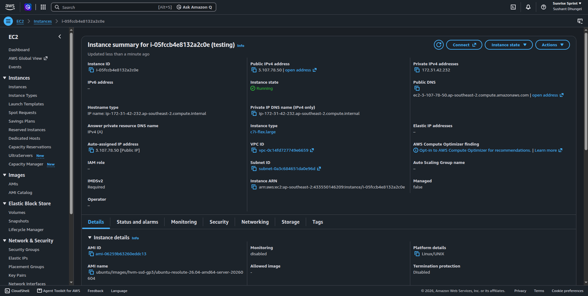
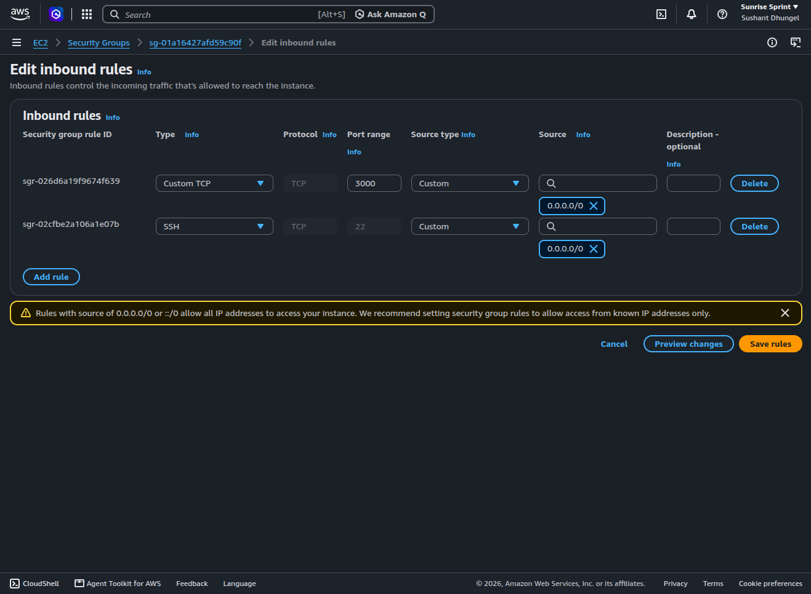
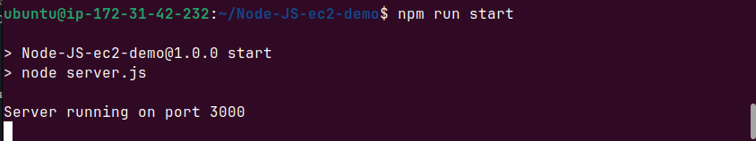
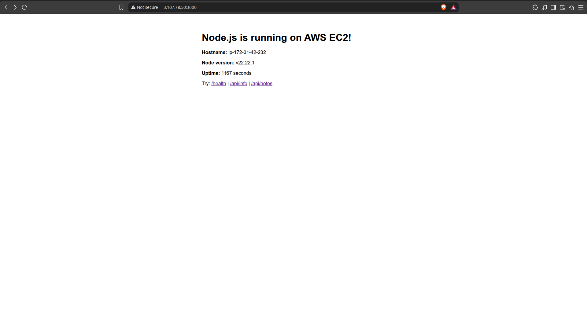
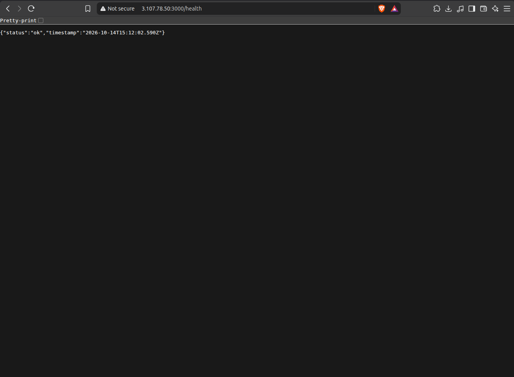
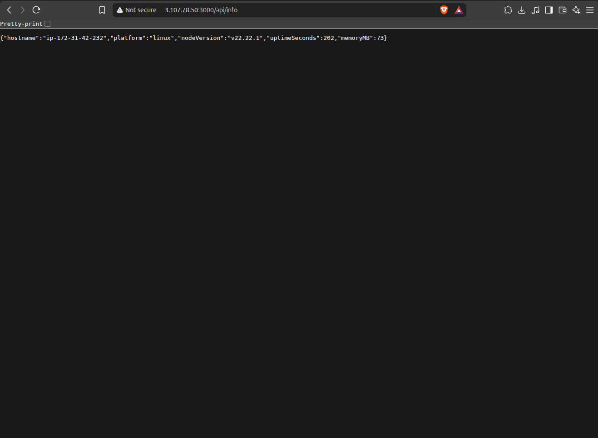
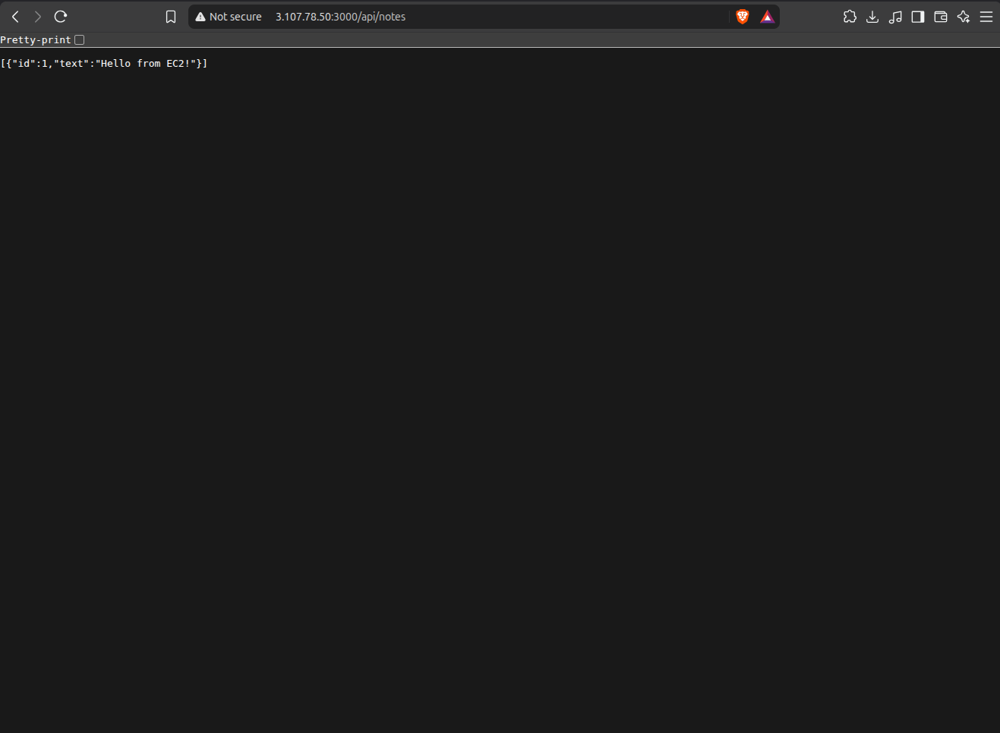
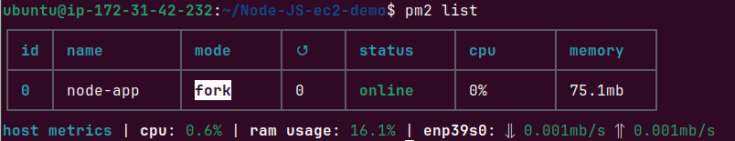
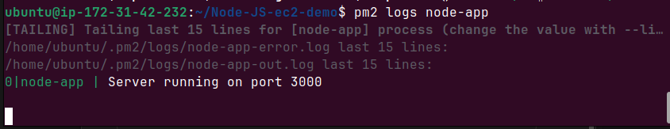

# Node.js Application Deployment on AWS EC2

## 1. Project Overview

This is a beginner DevOps project in which I deployed a Node.js web application on an AWS EC2 instance running Ubuntu Linux.

The purpose of this project was to learn how to deploy an application to a cloud server and make it accessible through a web browser.

## 2. Technologies Used

- AWS EC2
- Ubuntu Linux
- Node.js
- Express.js
- Git and GitHub
- SSH
- PM2

## 3. Architecture

```
Developer → GitHub Repository → AWS EC2 → Node.js Application (PM2) → Web Browser
```

## 4. Deployment Steps

1. Created an AWS EC2 instance with Ubuntu Linux (region: Asia Pacific – Sydney, `ap-southeast-2`).
2. Configured the security group to allow the required network traffic:

   | Type       | Protocol | Port | Purpose                  |
   |------------|----------|------|--------------------------|
   | SSH        | TCP      | 22   | Remote access to server  |
   | Custom TCP | TCP      | 3000 | Node.js application      |

3. Connected to the instance using SSH:

   ```bash
   chmod 400 my-key.pem
   ssh -i my-key.pem ubuntu@<EC2_PUBLIC_IP>
   ```

4. Installed Git and Node.js, then verified the installation:

   ```bash
   node -v    # v22.22.1
   npm -v
   git --version
   ```

5. Cloned the application repository from GitHub:

   ```bash
   git clone https://github.com/SushantDhungel/Node-JS-ec2-demo.git
   cd Node-JS-ec2-demo
   ```

6. Installed application dependencies using `npm install`:

   ```bash
   npm install
   ```

7. Started the application using `npm start`:

   ```bash
   npm run start
   # Server running on port 3000
   ```

8. Tested the application through a web browser at `http://<EC2_PUBLIC_IP>:3000`.
9. Used PM2 to run the application in the background so it keeps running after the SSH session is closed:

   ```bash
   sudo npm install -g pm2
   pm2 start server.js --name node-app
   pm2 list
   pm2 logs node-app
   ```

## 5. Application Access

Application URL: `http://YOUR_EC2_PUBLIC_IP:3000`

Replace the placeholder with your EC2 public IP address and port.

Available endpoints:

| Endpoint      | Description                                      |
|---------------|--------------------------------------------------|
| `/`           | Home page showing hostname, Node version, uptime |
| `/health`     | Health check (returns JSON status)               |
| `/api/info`   | Server information (platform, memory, uptime)    |
| `/api/notes`  | Simple REST API (GET and POST)                   |

**Note:** The application URL is accessible only while the instance and application are running and the security group permits the connection.

## 6. Screenshots

### AWS EC2 Instance



### Security Group Inbound Rules



### Running the Application on the Server



### Application Running

**Home page**



**Health check endpoint**



**Server info endpoint**



**Notes API endpoint**



### PM2 Process Management

**Process list**



**Application logs**



## 7. What I Learned

- Creating and managing an EC2 instance.
- Connecting to a Linux server using SSH.
- Installing and running a Node.js application.
- Using Git and GitHub for version control.
- Configuring EC2 security groups.
- Running a Node.js app as a background process with PM2.
- Troubleshooting application deployment issues.

## 8. Challenges Faced

- **App not reachable from the browser:** The application ran fine on the server, but it could not be opened from outside until I added an inbound rule for port 3000 in the security group.
- **App stopped when the terminal closed:** Running `npm start` directly ties the app to the SSH session. I solved this by using PM2 to run it as a background process.
- **Listening on the right interface:** The app listens on `0.0.0.0` instead of only `localhost`, so it can accept connections from outside the instance.

## 9. Future Improvements

- Configure Nginx as a reverse proxy.
- Configure PM2 to start automatically after a server reboot (`pm2 startup`).
- Restrict SSH (port 22) to my own IP address instead of `0.0.0.0/0`.
- Attach an Elastic IP so the public IP does not change when the instance restarts.
- Configure HTTPS with a domain name.
- Automate deployment using GitHub Actions.
- Add monitoring and logging.

## 10. Author

GitHub: [SushantDhungel](https://github.com/SushantDhungel)